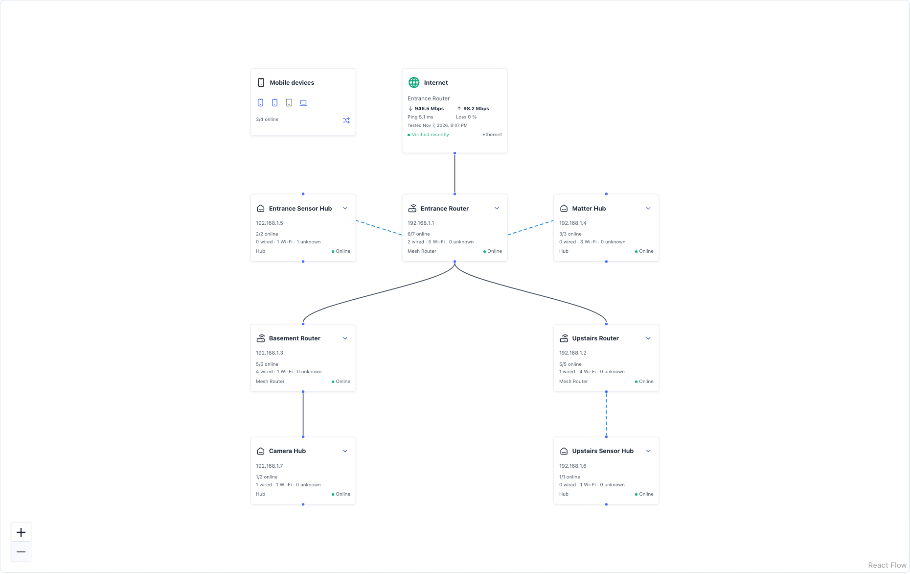

# Network Map

The **Network Map** shows network connections rather than room membership. Routers,
mesh routers, switches, access points, network hubs and smart-home hubs form the
infrastructure overview. Endpoints remain in searchable device windows instead of
crowding the canvas with a tile for every device.

*Illustrative demo using sample English names, private addresses and Speedtest
measurements, not a real user's inventory. Connections are configured for this
example; LanGuard does not infer them from names or subnets.*

## Inspect and edit connections

1. Open **Network Map** from the navigation.
2. Select a router or hub to see its directly connected devices. Search or filter
   by status, connection type or device type. This list can include an upstream
   infrastructure peer; it is not a recursive list of every downstream endpoint.
3. Select a connection line to inspect its interfaces and evidence. Use
   **Edit connection** to change endpoints, or edit its type, ports and label in
   the drawer. A pencil beside a connection in a device window opens the same
   editor. Entering layout-edit mode is not required.
4. Open an individual device page from the device window when more detail is needed.

Merged devices appear once, while links retain their actual network interfaces.
Different interfaces or port names can have separate links between the same pair
of devices. Editing or removing a line does not delete an inventory device or
change its scanner presence state.

## Add connections

Choose **Edit map > Add connection** for a single connection. Select both devices,
their network interfaces, optional port names, the connection type and an optional
label.

For several devices, choose **Connect devices**, or open **Unconnected**, select
devices and use **Connect selected**. Pick the upstream device and interface, then
review the selected devices and connection type. Multi-interface devices have
explicit interface selectors. A bulk group is applied together or not at all.

Already-connected devices are hidden from the device picker by default. Enable
**Show connected devices** to add another link explicitly; it does not remove an
existing connection. Selected devices remain as chips and disappear from the
dropdown. Accepted pending connections are also excluded from the unconnected list.

In edit mode, a device's connection grip can be dragged from the unconnected list
onto an infrastructure node. A single-interface pair creates a manual connection
with an **Unknown** transport; multiple interfaces open a selection form first.
Mouse, touch and keyboard dragging are supported.

## Mobile devices

Phones, tablets, laptops and watches are grouped from their saved role or icon.
On desktop and tablet, devices with saved associations appear in a group beside
their assigned infrastructure node, separated by connection type. Select a group
or its line to inspect the individual saved connections.

Unassigned mobile devices have a separate group with a roaming icon. Its tooltip
means **no fixed access-point assignment**, not that roaming was detected. No
uplink is invented. **Connect unassigned** opens a bulk connection form with those
devices selected. On phone-sized displays, the mobile summary sits above the map.

Device type alone does not prove Wi-Fi: a laptop may use Ethernet. Names, vendors,
subnets and room assignments do not establish which access point a device uses.
Actual automatic roaming would require an integration that reports current client
associations; inventory scans alone do not supply that information.

## Internet and Speedtest

Use the **globe+** action to add an **Internet** node. Choose the router or other
network device, its network interface and the connection type, then **Save**.
Select the globe or its line to edit the assignment or remove it. Removing the
globe leaves inventory devices and their other connections unchanged.

The globe is a virtual topology node, not an invented device with a fake MAC or IP.
If its assigned interface becomes unavailable, the connection is not silently
redirected to another device.

When [Speedtest Tracker](/docs/integrations#speedtest-tracker) is enabled and
configured, the Internet tile displays the latest available download and upload
speeds in Mbps, ping, packet loss and the test timestamp. It reuses the integration
data already loaded by LanGuard; opening or refreshing the map does not launch a
new bandwidth test.

| Indicator | Meaning |
| --- | --- |
| **Verified recently** | A completed test with a positive download or upload measurement is at most 15 minutes old. Internet access was demonstrated **at the time of that test**. |
| **Degraded** | A recent completed test demonstrates access, but Speedtest Tracker reports failed performance thresholds. This is not an offline status. |
| **Last test only** | Measurements exist, but do not qualify as recent Internet-access verification. The timestamp remains visible. |
| **Unverified** | No qualifying result is available, or Speedtest Tracker cannot currently be read. This does not establish an Internet outage. |
| **Manual uplink** | No enabled, configured Speedtest integration supplies verification. The globe represents the saved manual assignment only. |

> **Measurement scope:** A successful API connection to a local Speedtest Tracker
> server does not by itself prove Internet access. Results describe the configured
> testing host and test timestamp; they are **not a live probe of the selected
> router, WAN interface, or every Internet destination**. A cached API refresh does
> not make an older test fresh again. Keep the testing host and WAN path in mind on
> multi-WAN networks.

## Read the lines

| Appearance | Meaning |
| --- | --- |
| Solid | Ethernet |
| Dashed | Wi-Fi |
| Dotted | Unknown transport |
| Dash-dot Wi-Fi with a mobile icon | An aggregated mobile-device group; select it for the underlying connections |

Evidence is separate from transport: manual links use the normal connection color,
confirmed LLDP evidence is green, unconfirmed suggestions are amber, and stale
observations are faded. Most individual labels appear on hover, focus or selection;
mobile-group labels remain visible.

## LLDP suggestions

Enable **LLDP suggestions** to review observations. Suggestions require an exact
match between a reported chassis MAC and an inventoried interface. Accept or
dismiss each observation explicitly. Unmatched neighbors are listed separately.
Names and shared subnets do not create links.

LLDP initially uses **Unknown** transport because it does not establish Ethernet
versus Wi-Fi. Missing or older-than-24-hour observations mark accepted links stale
instead of deleting them. The suggestions toggle is a per-user database preference
that survives refreshes and restarts; it does not approve observations.

## Layout and saving

The canvas starts at a readable zoom. **Center map** recenters it without shrinking
tiles to fit a very wide network. Pan and zoom as needed. **Unconnected** toggles
the inventory panel to give the canvas more room. **Automatic layout** packs
separate components into multiple columns while laying out connected branches.

Use **Edit map**, drag tiles by their grips, then **Done** to save positions. There
is one saved network layout, separate from the Home Map. Upgrading from the older
full-device map consolidates any saved infrastructure arrangement, or rebuilds
obsolete coordinates automatically, without deleting physical connections.

Connection and layout changes enter a durable background queue. **Pending** means
the server accepted the request, not that it has already been applied. A running
scan may delay execution; no repeated Save click is needed. **Save history** shows
pending, saved and failed requests. Accepted requests survive page refreshes and
worker restarts, and retried intake requests cannot create duplicate writes.

Inventory membership, permissions and revisions are checked again when a request
is applied. Conflicting edits fail rather than overwriting newer changes. A failed
bulk group leaves no partial connections. A server outage before intake can be
confirmed preserves the form rather than claiming success.

Connection edits require device-edit permission; tile positions require Home Map
edit permission. Read-only users can inspect the map and save their own LLDP
display preference. Visitors and archived devices are omitted. Connections hidden
by archiving or merging are retained and may reappear with their endpoints.
